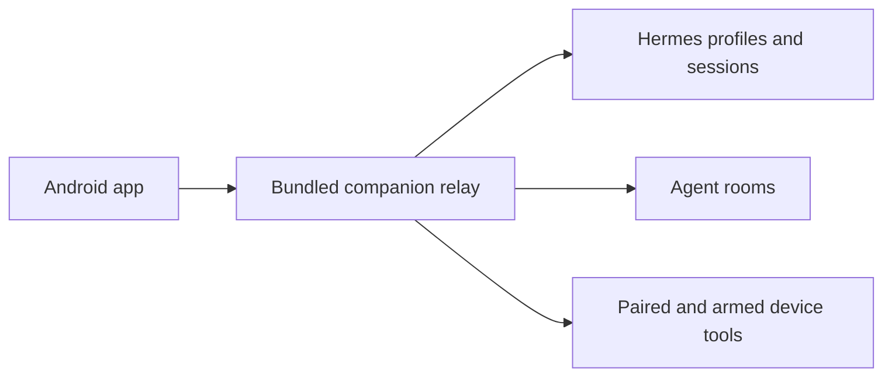

<p align="center">
  
</p>

# Hermes Companion

A native Android companion for a self-hosted [Hermes Agent](https://hermes-agent.nousresearch.com/). Browse threads, chat with profiles, use agent rooms and explicitly arm supported phone-control tools. The agent runs on your host; this app is its mobile interface.

[Setup](#setup) · [Build](#build-from-source) · [Protocol docs](#documentation) · [Related projects](#related-projects)

## What it includes

| Area          | Features                                                   |
| ------------- | ---------------------------------------------------------- |
| Conversations | Threads, profiles, streamed chat and coding-agent sessions |
| Rooms         | Multi-profile conversations, mentions and interruption     |
| Pairing       | Host approval of a device pairing code                     |
| Device tools  | Status, snapshots and gestures when armed and permitted    |
| Notifications | Optional notification stream with configurable routing     |

This repository includes its own `hermes-plugin/` relay. It is distinct from the older archived `hermes-companion` prototype and the separate mailbox-oriented web/plugin projects.

## Setup

You need Android **12+**, a running Hermes host and a reachable host address over your intended LAN or private network.

1. Inspect and install the bundled relay on the Hermes host:

   ```sh
   ./hermes-plugin/install.sh
   ```

2. Start a new Hermes session or restart its configured gateway/relay. The companion relay uses port **9120**; use its origin in the app, rather than the dashboard's port. Keep the service behind your intended private network.
3. Install an APK from [Releases](https://github.com/coding-nyx/hermes-companion-app/releases), when available, or build it below. Enter the relay origin in the app. `127.0.0.1` on a phone means the phone itself.
4. On the phone, open **Device → Pair**. Approve the displayed device code on the host:

   ```sh
   hermes companion approve <PAIRING_CODE>
   ```

5. Chat through Threads/Chat. Device control is optional: grant the required Android accessibility/overlay/notification permissions, then explicitly **Arm** it. Use **Disarm** to stop control. Review Device-tab protection rules; do not assume a built-in protected-app list.

See the [operator protocol](docs/protocol/operator.md) and [mobile-control protocol](docs/protocol/mobile-control.md) for the host/device contract.

## Build from source

Use JDK **17**, an Android SDK with API **35**, and the checked-in Gradle wrapper. Dependencies and versions are pinned in `gradle/libs.versions.toml`.

```sh
./gradlew :app:assembleDebug
./gradlew :app:testDebugUnitTest
./gradlew :app:assembleRelease
```

The release APK is under `app/build/outputs/apk/release/`. Without a configured release keystore, the build falls back to the debug signing key and warns; that is a sideload/testing artifact, not evidence of a production-signed release.

Provide signing values through `HERMES_KEYSTORE_PATH`, `HERMES_KEYSTORE_PASSWORD`, `HERMES_KEY_ALIAS` and `HERMES_KEY_PASSWORD`, or an ignored `keystore.properties` file. Never commit a signing key or password.

## Architecture



Feature modules cover connect, threads, chat, profiles, gateway and device UI. Shared modules own models, design, domain and local/remote data. See `settings.gradle.kts` for the module list.

## Documentation

- [Plugin implementation and setup](hermes-plugin/README.md)
- [Product plan](docs/PLAN.md)
- [Operator protocol](docs/protocol/operator.md)
- [Mobile control](docs/protocol/mobile-control.md)
- [Rooms](docs/protocol/rooms.md)
- [Agent sessions](docs/protocol/agent-sessions.md)
- [Contributor/agent conventions](AGENTS.md)

## Related projects

- [Archived Android prototype](https://github.com/coding-nyx/hermes-companion) — historical work.
- [Web companion](https://github.com/coding-nyx/hermes-companion-web) and [platform plugin](https://github.com/coding-nyx/hermes-companion-plugin) — a separate mailbox/node implementation; pairing protocols and ports are not interchangeable.

No top-level project license file is present. This README describes source behavior; it does not certify a connected host, current release signing or hardware permissions.
