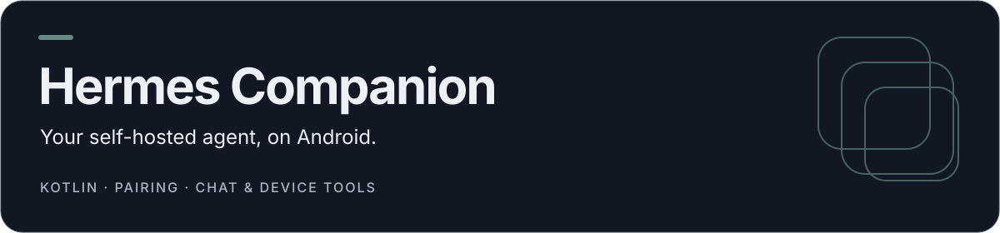
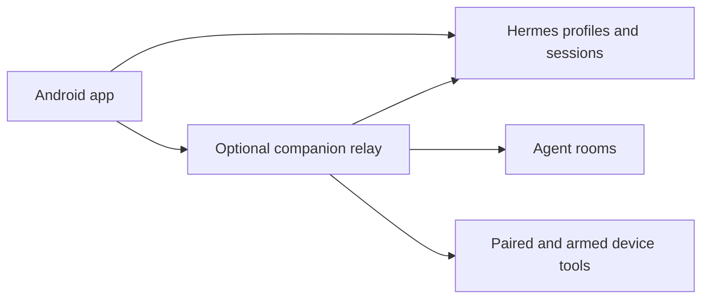

<p align="center">
  
</p>

# Hermes Companion

A native Android companion for a self-hosted [Hermes Agent](https://hermes-agent.nousresearch.com/). Browse threads, chat with profiles, use agent rooms and explicitly arm supported phone-control tools. The agent runs on your host; this app is its mobile interface.

[Setup](#setup) · [Build](#build-from-source) · [Protocol docs](#documentation) · [Related projects](#related-projects)

## What it includes

| Area          | Features                                                   |
| ------------- | ---------------------------------------------------------- |
| Conversations | Threads, profiles, streamed chat and coding-agent sessions |
| Rooms         | Multi-profile conversations, mentions and interruption     |
| Pairing       | Host approval of a device pairing code                     |
| Device tools  | Status, snapshots and gestures when armed and permitted    |
| Notifications | Optional notification stream with configurable routing     |

This repository includes its own `hermes-plugin/` relay. It is distinct from the older archived `hermes-companion` prototype and the separate mailbox-oriented web/plugin projects.

## Setup

You need Android **12+**, a running Hermes host and a reachable host address over your intended LAN or private network.

For **native chat, threads and host telemetry**, connect to a reachable Hermes dashboard, usually port **9119**, or its HTTPS reverse-proxy URL. A loopback-only dashboard needs your existing authenticated LAN/Tailscale or proxy exposure before the phone can reach it. Native chat does not require the plugin or device pairing. Password authentication is supported; native OAuth remains pending.

For **Hands, notification streaming, custom rooms and the agent console**, use the optional bundled relay:

1. Inspect and install the bundled relay on the Hermes host:

   ```sh
   ./hermes-plugin/install.sh
   ```

2. Start a new Hermes session or restart its configured gateway/relay. The companion relay uses port **9120**; use its origin in the app for the full plugin integration. Keep the service behind your intended private network.
3. Install an APK from [Releases](https://github.com/coding-nyx/hermes-companion-app/releases), when available, or build it below. Enter the relay origin in the app. `127.0.0.1` on a phone means the phone itself.
4. Pair once for phone integration. You can run `hermes companion qr` on the host to scan/tap a pairing link, or open **Device → Pair** on the phone. Approve the displayed device code on the host:

   ```sh
   hermes companion approve <PAIRING_CODE>
   ```

5. Chat through Threads/Chat. Device control is optional: grant the required Android accessibility/overlay/notification permissions, then explicitly **Arm** it. Use **Disarm** to stop control. Review Device-tab protection rules; do not assume a built-in protected-app list.

**New** reserves a host session; Hermes persists its conversation when the first message arrives. Tap the chat title for rename, pin, archive and branch. A running turn offers **Steer** with text or **Interrupt** with an empty draft. Delivery labels distinguish queued, sending, sent, failed and uncertain input: **Sent** means acknowledged by Hermes, **Retry** follows an explicit rejection, and **Check** reads history without automatically resubmitting an uncertain send.

The rich-text composer keeps formatting visible and supports expanded draft editing. Tap the center **Voice** dock to open voice controls; long-press it to dictate into the selected conversation. Model and reasoning controls apply to that conversation and show host-confirmed settings. System speech remains available; native Host speech/streaming and realtime rollout remain disabled pending their acceptance gates. See the [prior reliability checkpoint and deferred work](docs/reviews/2026-10-15-closeout.md).

### Grouped interface checkpoint

The current interface uses consistent typography and spacing, grouped settings, focused detail sheets and system light/dark appearance across the existing app. Chat transcripts stay open, with vertical composer actions and the center Voice dock available through navigation.

The Grouped APK is installed on the S22 and its checksum is verified. The clean Companion publication snapshot passes **602 automated tests**, debug and minified release builds, and release lint with no errors (52 warnings). **S22 interaction checks, manual accessibility review and spoken recognition/conversation tests remain deferred.** This update does not enable incoming calls or retire remaining plugin services. Native session reads can recover a rotated loopback token once, within the connected host and proxy prefix; chat submissions are never replayed by this recovery. Exact scope, validation results, APK hashes and local rollback details are recorded in the [Grouped implementation checkpoint](docs/reviews/fixtures/2026-10-15-grouped-implementation.json).

See the [operator protocol](docs/protocol/operator.md) and [mobile-control protocol](docs/protocol/mobile-control.md) for the host/device contract.

## Build from source

Use JDK **17**, an Android SDK with API **35**, and the checked-in Gradle wrapper. Dependencies and versions are pinned in `gradle/libs.versions.toml`.

```sh
./gradlew :app:assembleDebug
./gradlew :app:testDebugUnitTest
./gradlew :app:assembleRelease
```

The release APK is under `app/build/outputs/apk/release/`. Without a configured release keystore, the build falls back to the debug signing key and warns; that is a sideload/testing artifact, not evidence of a production-signed release.

Provide signing values through `HERMES_KEYSTORE_PATH`, `HERMES_KEYSTORE_PASSWORD`, `HERMES_KEY_ALIAS` and `HERMES_KEY_PASSWORD`, or an ignored `keystore.properties` file. Never commit a signing key or password.

## Architecture



Feature modules cover connect, threads, chat, profiles, gateway and device UI. Shared modules own models, design, domain and local/remote data. See `settings.gradle.kts` for the module list.

## Documentation

- [Plugin implementation and setup](hermes-plugin/README.md)
- [Product plan](docs/PLAN.md)
- [Operator protocol](docs/protocol/operator.md)
- [Mobile control](docs/protocol/mobile-control.md)
- [Rooms](docs/protocol/rooms.md)
- [Agent sessions](docs/protocol/agent-sessions.md)
- [Contributor/agent conventions](AGENTS.md)
- [Current Conduit parity backlog](docs/reviews/2026-10-13-current-conduit-parity-backlog.md)
- [Grouped interface validation and rollback](docs/reviews/fixtures/2026-10-15-grouped-implementation.json)
- [Prior reliability validation and rollback](docs/reviews/2026-10-15-closeout.md)

## Related projects

- [Archived Android prototype](https://github.com/coding-nyx/hermes-companion) — historical work.
- [Web companion](https://github.com/coding-nyx/hermes-companion-web) and [platform plugin](https://github.com/coding-nyx/hermes-companion-plugin) — a separate mailbox/node implementation; pairing protocols and ports are not interchangeable.

No top-level project license file is present. This README describes source behavior; it does not certify a connected host, current release signing or hardware permissions.

Cleartext HTTP is accepted only for permitted LAN/private-network hosts; public hosts must use HTTPS. Credentials are scoped to the dashboard origin and reverse-proxy prefix.
