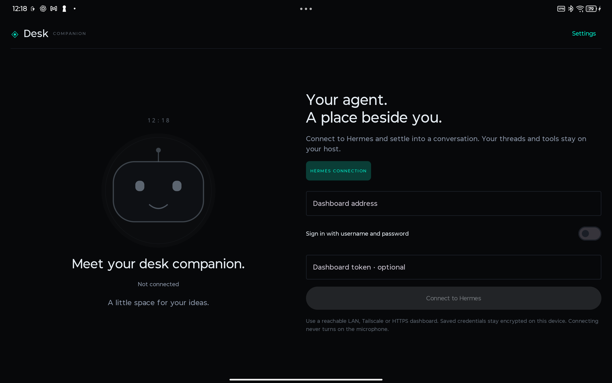
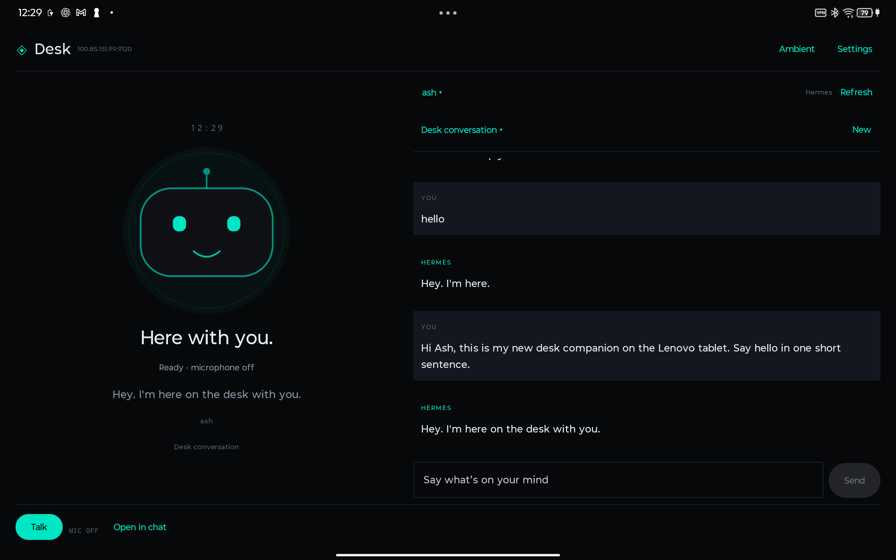

# Desk Companion — 0.3.0

The separate Android 16+ tablet app now offers **Hermes**, **native ChatGPT account sign-in**, and **native Grok conversations using lab’s existing OAuth account**. The expressive robot/Desk Perch home and hidden camera sharing remain the main interface. No new provider API keys were added.

- **Connections → Continue with ChatGPT:** opens the system browser for the documented plan-usage OAuth flow. Complete consent yourself, return to Desk, then choose/create a local conversation in History. Credentials are encrypted and identity-verified; the model picker uses the account’s catalog. Real-account ChatGPT inference still needs this user sign-in; fixture acceptance is not a substitute for it.
- **Connections → Connect Grok:** uses the separate private [Desk Bridge](../desk-bridge/README.md) on lab, port 9121. The tablet owns the conversation loop and encrypted history. Lab attaches its Grok OAuth credential; it does not run a Hermes agent turn. Provider credentials stay on lab. This connection currently has conversation/vision inference, not device tools.
- **Connections → Use saved Hermes:** restores the original host/profile/conversation. Hermes sessions, tools and compaction remain distinct from the native provider threads.
- **Settings → Voice setup and test:** select Hermes or Device speech independently of the conversation provider. Host speech can speak native ChatGPT/Grok replies. Test the speaker, set conversation start preference, choose Quick/Natural/Patient response timing and Soft voice/Normal/Noisy room sensitivity. Quiet windows and empty/noise-only transcription resume listening without requiring a Resume tap.
- **Settings → Device presets:** open the tablet browser or Android Settings. During active voice, say “open browser” or “open tablet settings”; the same exact typed commands work. These launch intents locally without sending a model prompt. Launching another app ends this screen’s microphone/camera session.

Native provider history is encrypted and partitioned by exact provider origin/account/session. HTTP inference carries the current text history with `store:false` and `stream:true`. Images are attached to one request and cleared from app-owned memory; they are not retained as a hidden photo history. Native provider history is not silently truncated; start a new thread when the local bound is reached. Native compaction is not implemented. Account sign-out attempts remote renewable-session revocation, clears local tokens and retains local conversations/account registration.

**Still planned:** dedicated local wake phrase, background voice service, full-duplex conversation, acoustic barge-in, fast acknowledgement/task-model orchestration, browser page reading, screen sharing and cross-app/phone/computer control. Voice in 0.3 remains a chained conversation that listens between replies. ChatGPT plan OAuth does not currently grant native realtime audio. The [implementation plan](../docs/superpowers/plans/2026-10-15-desk-providers-voice-and-device-control.md) defines the next audio, wake and device-control milestones and their acceptance gates.

## 0.3 validation

Local checks: 51 targeted Desk tests (35 feature tests, 16 app speech/provider tests), 22 shared voice-engine regression tests, and 7 broker tests passed. Coverage includes PKCE/loopback state and signed identity validation, provider/account history isolation, ephemeral image requests, mid-stream failure, cancellation, whole-context requests, exact command matching and noise-to-listening recovery. Debug/app-test APKs assemble and desk lint has zero errors.

Physical acceptance uses the real Lenovo with automatic voice entry suppressed only inside the instrumentation process. All four tablet acceptance tests passed. The live Grok test sent an artificial red JPEG, verified that the model identified red, and returned to the saved Hermes binding. It never opened a camera. Setup/UI checks do not enable microphone or camera. The browser preset test intercepts the Android browser intent and verifies no model prompt is sent, so it does not navigate the operator’s actual browser.

Evidence: `/tmp/hermes-desk-providers-final-build.log`, `/tmp/hermes-desk-providers-device-final.log`, `/tmp/hermes-desk-providers-ui.log`, `/tmp/hermes-desk-bridge-tests.log`. ChatGPT sign-in/identity transport is tested with local signed fixtures; real ChatGPT account access, room-microphone quality, acoustic interruption and long natural conversations remain user acceptance work.

Installed 0.3.0 APK SHA-256: `9f3c595abdc633f853e5254186f55bf0df66741b965a2869075b90994b2da823`. The final copy-only setup clarification was rebuilt and all three UI/preset restoration checks passed again (`/tmp/hermes-desk-providers-release-build.log`, `/tmp/hermes-desk-providers-release-device.log`). App data and existing Hermes selection were preserved. Test-only native Grok fixture conversations remain in local history.

## Prior 0.2.0 delivery

The Lenovo build now uses the selected **Desk perch** home and an expressive full-body robot. History and typing are secondary sheets. Camera imagery is hidden; sharing keeps a recent frame in memory and attaches it to the agent's next request. **Look at this** captures one frame and asks the selected agent to describe it.

Speech is swappable between **Hermes** (the host's configured transcription and voice) and **Device** compatibility speech. Hermes input uses app-owned PCM capture, avoiding recognizer-service beeps and keeping quiet listening windows available. Replies are synthesized from streamed text clauses. No provider key was added or requested by this implementation. First voice use explains processing and requests permission; its start-on-open choice defaults on, while explicit mute/end persists.

Settings exposes the host's actual session model catalog and Fast/Balanced/Deep reasoning controls. Changes are scoped to the selected session; provider confirmation requirements are preserved. History includes native context usage and **Compact**. A durable pending marker prevents automatic retry of unconfirmed compaction, including across restart. Compaction is explicit in this increment; the host's own normal automatic compaction policy is preserved.

**0.2 limits (historical):** Voice remains a chained, turn-based conversation. A separate fast conversation model, natural acoustic barge-in, independent direct ChatGPT/Claude/Grok account adapters, and phoneme/audio-aligned character speech are not delivered by this increment. Selecting a model through Hermes uses the host's configured providers/authentication. Camera sharing sends selected frames with requests, not a continuous video stream. The robot's speaking pose follows playback state, with stylized timed mouth movement.

## Redesign validation — October 15, 2026

- 37 targeted tests passed: 33 desk coordinator/render/frame tests and 4 host-speech lifecycle tests. Coverage includes hidden history/camera controls, microphone readiness, compaction ambiguity/restart, image-before-prompt ordering and late speech cancellation.
- Debug APK and instrumentation APK assembled; desk debug lint passed with zero errors.
- Physical Lenovo acceptance passed for saved connection/conversation restoration, the new home/history/camera/settings surfaces and preserved permissions. Camera controls do not open a sensor merely by being shown.
- The saved lab speech service transcribed generated audio and synthesized/played a short reply on the Lenovo. The test uses synthetic speech; its entry gate suppresses automatic recording without changing the user's preferences.
- A generated red-square/blue-circle picture reached the explicitly selected test conversation, and the agent identified both. This acceptance test never opens a camera.
- Physical microphone accuracy, acoustic interruption and a long human conversation remain acceptance work. Camera capture is implemented behind explicit permission/sharing; the automated vision acceptance validates the upload/model path using artificial pixels.

Evidence logs: `/tmp/hermes-desk-redesign-final-build.log`, `/tmp/hermes-desk-redesign-device.log`, `/tmp/hermes-desk-redesign-host-speech.log`, `/tmp/hermes-desk-redesign-vision.log`. The preceding installed APK is retained at `/tmp/hermes-desk-redesign-acceptance/before-0.1.0.apk` for rollback. Existing app data was not cleared.

Installed 0.2.0 APK SHA-256:

```text
96973426562a29d23a760a8019e3ebe484716608061fb506cf4ea310b68fad0e
```

The following sections retain the original prototype's scope/validation history. The 0.2.0 behavior above supersedes its visible chat pane, Ambient switch, manual-only voice entry and later-only camera descriptions.

## Original 0.1.0 prototype

**Product direction:** Requested V1 is a character-first continuous voice companion with camera sharing and Hermes, OpenAI/ChatGPT, Claude and Grok integrations. The revised [conversation and implementation plan](../docs/superpowers/plans/2026-10-15-desk-continuous-conversation-v1.md) supersedes this prototype's chat-led UI and manual half-duplex Talk flow. Features and validation below describe the installed prototype, not completion of revised V1.

The [redesign execution plan](../docs/superpowers/plans/2026-10-15-desk-redesign-implementation.md) adds the selected Desk perch layout and expressive robot, concrete screens/code boundaries, build checkpoints and normal compaction for V1.

A separate Android 16+ tablet application that gives an existing Hermes conversation a character, captions and foreground voice. Package: `app.hermes.desk`. It installs alongside Hermes Companion and owns its own credentials and preferences.

## Included

- Native responsive character and conversation views for landscape, portrait and narrow windows.
- Native Hermes dashboard connection, profiles, existing conversations and explicit new-thread creation.
- Streamed text, actual tool/turn state, ordinary approval and clarification responses, and task interruption.
- Device PIN/biometric confirmation for destructive approvals. Secret/sudo requests hand off to the existing Companion app.
- Opt-in foreground system speech, explicit microphone state and End voice. Ending voice leaves a submitted host task running; Stop task requests host interruption.
- Charging-aware keep-screen-on, ambient view, private captions and reduced-motion settings.
- Encrypted credentials, drafts and delivery journal. Uncertain sends are never automatically retried.
- Open in chat handoff to Hermes Companion when it is installed and configured for the selected host.

Hermes is the only implemented backend in this prototype. The backend interface separates connection/session work from character and speech presentation. Additional direct providers and continuous voice are required by revised V1 and are not implemented by this APK. It also does not implement camera capture, a wake word, background recording, realtime acoustic interruption, phone Hands or the Pi bridge.

## Connect and use

1. Open **Desk Companion** and enter a reachable Hermes dashboard URL, normally the dashboard on port 9119 or an HTTPS reverse-proxy URL. A relay exposing the native operator routes can also be used.
2. For password-authenticated hosts, turn on username/password sign-in and enter those credentials. For token-based hosts, enter the dashboard token when needed. Public hosts require HTTPS; HTTP is restricted by the shared transport to permitted private-network hosts.
3. Choose a profile and conversation, or select **New**. Opening the app and connecting never start microphone capture.
4. Type and send, or tap **Talk** and grant microphone access. System speech availability, supported language and network requirements depend on the tablet's installed recognition/TTS engines.
5. **End voice** stops capture and playback. **Stop task** sends an explicit interruption to Hermes. **Ambient** hides the detail pane; Settings controls caption privacy, motion and keeping the display awake while charging.

Saved credentials are reused for the same exact configured origin when credential fields are left blank. Disconnecting retains that encrypted configuration. The app reconnects to the saved host and restores an eligible previously selected conversation when reopened. Explicit Disconnect / change host pauses automatic reconnection until a successful manual connection. A process restart never resumes recording or replays audio. Browser-only/OIDC authentication is not supported in V1.

## Modules

| Module | Responsibility |
| --- | --- |
| `desk-app` | Android 16 application, secure storage, Hermes adapter, Activity, permission/biometric handling and voice composition |
| `feature-desk` | Character, adaptive screen, backend contract and conversation coordinator |
| `core-voice` | Shared foreground speech engine, input/output ports, system recognizer/TTS and audio focus ownership |
| Existing shared modules | Design, core message/session types, Hermes transport and domain policies |

The phone app still compiles/targets SDK 35 and supports Android 12+. Only `desk-app` has minimum/target SDK 36. The repository build uses AGP 8.9.1 and Gradle 8.11.1 for the Android 16 application.

## Build and install

Use JDK 17+, Android platform 36 and the checked-in Gradle wrapper:

```sh
./gradlew :desk-app:assembleDebug
adb -s YOUR_TABLET_SERIAL install -r desk-app/build/outputs/apk/debug/desk-app-debug.apk
adb -s YOUR_TABLET_SERIAL shell am start -n app.hermes.desk/.DeskActivity
```

The debug APK is a sideload artifact. The current release build configuration also uses the debug signing key; production signing is not configured for this new app.

## Validation on October 15, 2026

- 576 JVM/unit/render tests passed across the desk feature, existing app, chat, threads, transport, storage, domain and core models. The desk feature contributes 15 coordinator tests and 8 render tests.
- Desk debug lint passed with zero errors. Remaining warnings include the intentional platform cleartext allowance guarded by the shared host policy, and style suggestions to use KTX helpers.
- Installed and launched on the Lenovo TB373FU running Android 16/API 36.
- Two instrumentation tests passed on the Lenovo: startup/settings without microphone permission or a leaked awake flag, and an end-to-end synthetic native Hermes connection/session/text-stream flow with one submission.
- The synthetic fixture used a local mock server; no real model prompt or microphone recording was used. Live microphone recognition, perceived speech quality, echo behaviour and extended charging operation still need acceptance on this tablet.
- Gradle's UTP launcher could not download a host installer dependency due to a network error. The already-built app/test APKs were installed with explicit-serial ADB and run directly with AndroidJUnitRunner instead.
- Fixture connection state and the instrumentation package were removed. The app was then launched fresh on the Lenovo connection screen.

Installed debug APK SHA-256:

```text
bcd30e02ce31854a3343ae570fbc80c4e1bd98645599b5ea6f8e139c211d2eb7
```

The full unit/render regression log is `/tmp/hermes-desk-final-regression.log`; the Lenovo instrumentation log is `/tmp/hermes-desk-lenovo-instrumentation.log` on the implementation workstation. A real Lenovo onboarding screenshot is saved in `preview/lenovo-onboarding.png`. Render fixtures are generated under `feature-desk/build/reports/desk-render/`.



## Live lab follow-up on October 15, 2026

Connected the Lenovo to lab over its Tailscale address using the reachable relay/dashboard on port 9120. The profile is `ash`. The host's port 9119 was not exposed on its Tailscale interface; no host or plugin configuration was changed.

Three explicit device checks passed: a live assistant reply in a dedicated conversation (including ambient/detail controls), restoration of the saved host/profile/session and history from a fresh process with the microphone off, and system TTS start/completion on the tablet speaker. The live conversation check verifies a nonempty assistant answer rather than requiring the model to obey an artificial fixed-token instruction. Two recognition services are installed, but no room microphone audio was captured during these checks.

The APK was updated to reconnect automatically to its saved configuration on launch; an explicit disconnect disables this until the next manual connection. The test package was removed and the application was left open and connected on the Lenovo. Evidence logs are `/tmp/hermes-desk-lab-acceptance.log`, `/tmp/hermes-desk-lab-restore.log` and `/tmp/hermes-desk-lenovo-speech.log`. The updated build, desk debug lint and 23 desk unit/render tests passed.



## Next increments

Follow the revised [V1 plan](../docs/superpowers/plans/2026-10-15-desk-continuous-conversation-v1.md): character home, durable conversation ownership, continuous voice with independent task delegation, direct OpenAI/ChatGPT/Claude/Grok adapters, explicit camera sharing and long-session acceptance. The system recognizer/TTS loop remains compatibility mode. Pi coordination stays on the hardware track.
