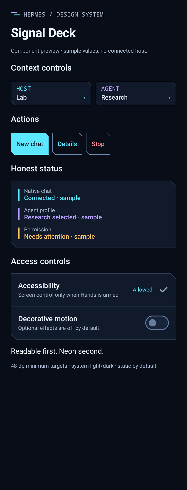

# Cyberpunk redesign: implementation review

This implemented review build follows the [complete redesign plan](../design/cyberpunk-redesign.md). It is not a production release or a claim that physical-phone acceptance has passed.

Base revision: `0e43d97ee63a44e74f63aaafbfd4f4bd759a695d`.
Work branch: `redesign/cyberpunk-command-center`.

## Evaluation APK

The intended prerelease is `v0.3.0-cyberpunk-preview.1`, version code `3`, for ARM64 Android 12+ (API 31). Build it with `-PhermesPreview=true`; the default stable application ID is unchanged.

- Preview package: `app.hermes.companion.preview`, launcher name **Hermes Preview**.
- Installs beside the existing Hermes app, rather than replacing it. Keep the existing app installed.
- The preview starts with its own configuration, Android permissions and pairing. It does not copy or migrate existing app data.
- Provider authorities, debug-tool action, notification-listener and accessibility readiness checks are scoped to the actual application package. Merely enabling those services for the stable app does not grant them to the preview.
- The shared `hermes-companion` link scheme may cause Android to offer an app chooser. Local notification taps explicitly target the application that posted them.
- This is a debug-signed evaluation build, not a production-signed update. The existing public `v0.2.0` APK and the local evaluation APK have different signing certificates. CI also uses its own evaluation key, so a differently signed older preview may not accept an in-place update.

## Implemented

- Ink, cyan and violet design tokens, system light/dark palettes, cut-corner grouped panels and actions, explicit context selectors and status components.
- Static-by-default signal signature. Optional 160 ms, 2 dp decorative displacement respects Android's disabled-animation setting. Loading indicators have static alternatives.
- Direct Chats / Gateway / Voice / Device / More navigation. Coding agents and agent profiles remain distinct destinations.
- Labeled Host and Agent selectors; New chat is accessible from other screens. Conversation model/reasoning controls remain scoped to their existing chat controls rather than pretending a host default is a session setting.
- Real conversation composer actions use the shared cut-corner controls. Model and reasoning entry points are visible without first focusing the editor; narrow landscape/keyboard layouts keep full touch targets.
- Agent choices use consistent host-scoped cards, explicit current selection, readable wrapping names, and a discoverable Close action. Enlarged-text Host/Agent selectors stack rather than squeezing names into narrow columns.
- The conversation model sheet separates last-confirmed state from pending requests. Global model requests are not mislabeled as host-confirmed. Voice state remains truthful while preparing the microphone; End voice stays reachable outside scrolling details.
- Host/profile chooser inspection and selecting the current context do not end voice. Confirmed changes end voice before changing ownership.
- Native dashboard and optional companion relay capabilities are explained separately. Native-only users can request Android notification permission without pairing phone control.
- Notification sharing destination and Android permission readiness are visible on the Device overview. Permission grants remain separate from arming Hands.
- Thread cards have explicit unread state, visible action menus, filter recovery and a persistent New chat action.
- Notification receipts do not navigate. Trusted taps and confirmed deep links preserve current voice ownership; pending cross-host navigation is scoped and consumed once.
- Native completion, approval/clarification and error events produce generic, deduplicated local alerts for known sessions on the connected host/profile. Visible unlocked conversations suppress redundant alerts.
- Relay topic subscriptions reconnect after transient failures, resume with the last accepted ntfy message ID and deduplicate replay. Configuration/security failures do not retry indefinitely. Topics and notification IDs are scoped to their owning host/profile.

See [gateway integration audit](../design/gateway-integration-audit.md) for protocol evidence and edge cases.

## Verified design milestone

The focused native Compose render suite passed 14 tests. Actual rendered views were visually inspected in light/dark and with enlarged text. Preview data is synthetic; screenshots are not evidence of a connected Hermes host or a physical phone test.

Generated review views:

- Component specimen, light and dark.
- Chats, Gateway, Device, host picker and enlarged-text chat list.
- 320 dp navigation target checks and voice-safe chooser interactions.

Full regression/build/lint results are recorded below. Large-font modal captures use Android resource font scaling as well as Compose density; a local-only density override does not propagate into modal windows.

### Rendered review gallery

These are real Compose renders using synthetic state, not image mockups or live-host screenshots.

- [Light component specimen](assets/cyberpunk-2026-10-20/elements-light.png)
- [Conversation, dark](assets/cyberpunk-2026-10-20/conversation-dark.png) / [light](assets/cyberpunk-2026-10-20/conversation-light.png)
- [Gateway and notification capabilities](assets/cyberpunk-2026-10-20/gateway-dark.png)
- [Device control and permission readiness](assets/cyberpunk-2026-10-20/device-dark.png)
- [Conversation model controls](assets/cyberpunk-2026-10-20/model-dark.png)
- [Chats at enlarged text](assets/cyberpunk-2026-10-20/chats-large-text.png)
- [Agent chooser at system 2× font scale](assets/cyberpunk-2026-10-20/agent-switcher-large-text.png)
- [Pinned voice controls at system 2× font scale](assets/cyberpunk-2026-10-20/voice-controls-large-text.png)

## Limits and remaining acceptance

- Existing relay notification topic users must re-save their topic once for the exact host address, including any proxy path. Legacy values remain stored but cannot safely be auto-attributed to a path. Merely editing a topic does not change a subscription.
- Native alerts are connected local notifications, not durable remote push. Android stopping the process can interrupt delivery. No production FCM producer or killed-app delivery guarantee has been added.
- Only observed, known sessions in the active host/profile can receive routable native alerts. Indistinguishable completion-only events cannot prove a new turn without observed progress.
- Host speech, incoming calls and native realtime feature gates remain unchanged.
- Phone control does not bypass Android PIN, biometrics, keyguard or app restrictions. The existing unlock preference requests Android's ordinary dismissal flow only.
- No live host credentials or production configuration were changed. No host deployment, host restart or device installation was performed. Source and test-APK publication are separate from installing or deploying them.
- Physical-phone TalkBack, real IME/rotation, microphone, permission round trips, notification tray/deep links, background delivery and live-host acceptance still require hardware/operator validation.
- Large text stacks context controls and keeps full accessible names. Exceptionally long host names can still truncate and be inspected in the chooser. Unselected dock labels use the documented icon-only fallback at large font sizes. Medium/expanded adaptive navigation remains planned.
- The separate preview identity avoids replacing the stable package; actual side-by-side installation still requires device validation. No uninstall or data-clearing step is required or recommended.

## Validation

- Bundled relay Python tests: 188 passed.
- The initial focused design milestone passed 14 render/interaction tests; these are included in the later suite, not added to its total.
- Final preview-identity Gradle `test`: **1,042 test executions passed**, with **0 failures, 0 errors and 0 skips**. This includes repeated debug/release variants; the main debug/domain set contains 704 executions.
- ARM64 preview assembly passed. The APK's actual metadata identifies **Hermes Preview**, `app.hermes.companion.preview`, version `0.3.0-cyberpunk-preview.1` / code `3`, minimum API `31`, and only `arm64-v8a` native libraries. APK signature verification passed.
- A separate default-configuration manifest check confirmed the stable package, launcher label, provider authorities and debug action remain unchanged. The preview was then restored and its assembled APK identity and signature reverified.
- Final Android debug lint passed with **0 errors, 23 warnings and 2 informational findings**. Publication repeats the full test/lint/build gate for the exact published source.

| Module | Debug / JVM | Release unit variant |
| --- | ---: | ---: |
| App | 246 | 184 |
| Core model | 1 | — |
| Domain | 242 | — |
| Data local | 35 | 35 |
| Data remote | 119 | 119 |
| Chat | 22 | — |
| Device | 19 | — |
| Threads | 20 | — |
| **Total** | **704** | **338** |

The new identity checks verify the merged package/label, provider authorities, unchanged service class namespaces, absence of a shared UID, and package-scoped debug action retaining its `DUMP` permission gate. Simulated settings regressions ensure enabling the stable app's accessibility or notification listener does not mark the preview's access as granted.

Lint warnings include the existing network-security base configuration (public HTTP is separately rejected by the app's origin policy), the incomplete production FCM token-refresh path, obsolete API guards, dependency/version-catalog suggestions, backup-rule guidance and unused resources. One warning is the stable launcher-name resource unused by the preview build. A successful lint run is not a claim that these warnings or the hardware acceptance items above are resolved.
