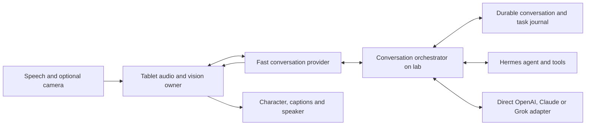

# Desk Companion V1: continuous conversation

**Status:** Product and implementation plan, October 15, 2026. The installed `0.1.0` APK is a Hermes connection/session prototype. It does **not** satisfy the revised experience. This plan supersedes the chat-led layout, manual Talk entry, 15-second listening timeout and later-only camera/provider scope in the earlier tablet plan.

**Platform:** Separate Android 16+ application, initially Lenovo TB373FU. Hermes, OpenAI/ChatGPT, Claude and Grok are all in V1 integration scope. Raspberry Pi purchasing remains in the separate shopping chat.

**Implementation decisions:** The user selected Desk perch with a rich expressive robot (superseding the creature concept) and accepted compaction for now. The [redesign implementation plan](2026-10-15-desk-redesign-implementation.md) defines the character rig, screens, file boundaries and build order. Its simple compaction policy supersedes the more elaborate checkpoint/rollover proposal below; semantic memory and a no-compaction session system are deferred.

**Latest constraints and delivery:** Speech must remain swappable without introducing API keys; use Hermes' existing configured speech/authentication first. Camera imagery is for agent vision and stays off the main screen. The installed 0.2.0 increment delivers the native robot/perch redesign, hidden frame sharing, Hermes/device speech, native session model/reasoning selection and guarded explicit compaction. Separate fast conversation delegation, acoustic interruption and direct provider account adapters remain unfinished; see `desk-app/README.md`.

## 1. Product experience

Open the configured application and meet the character. Speak naturally; it answers in speech and stays available for the next sentence. Conversation continues while an agent works. The character notices attention immediately; the assistant offers a short, relevant acknowledgement when a task will take time. No periodic listening beeps, repeated greetings or mandatory Talk taps between turns.

Home contains the character, a small assistant selector, microphone/camera state, optional short captions and controls for mute, camera, end conversation and settings. Full history, keyboard input, task details and configuration live in secondary sheets. Approvals appear as temporary cards. No permanent message rail or composer occupies home. Lip motion follows audible playback, with reduced-motion and accessible text alternatives.

### Voice on entry

- First launch selects/connects an assistant, chooses a voice and requests microphone permission. Offer **Start voice when I open Desk** enabled as the normal onboarding choice, with a clear explanation of where speech goes. Permission denial leaves secondary captions/keyboard available.
- Later foreground launches restore the logical conversation, connect and start voice when the saved choice, permission, unlock state and audio ownership allow it. Show Listening only after capture and transport are ready. Show connection setup only when configuration/authentication needs attention.
- Mute persists through recreation and relaunch, overriding automatic start. End conversation also pauses automatic voice entry until Resume. Rotation is not a new call and cannot reset mute.
- Ordinary silence leaves the foreground conversation ready; remove the 15-second timeout for this mode. Do not periodically ask whether the user is still there. Idle suspension is a separate optional setting, disabled for the normal desk experience. Show configured spending limits before they end a metered call.
- Backgrounding, screen lock, permission revocation or lost audio ownership stops capture/playback. Returning from background keeps that suspended call paused until Resume; opening the configured app afresh follows the saved entry preference. No boot-time recorder in V1.
- Camera starts off; its permission and sharing controls are independent of microphone preference.

Quiet operation requires continuous app-owned capture/playback. Repeatedly restarting Android's general SpeechRecognizer can produce service-controlled tones and cannot guarantee this experience. Do not mute system sounds globally to hide those tones.

## 2. Conversation contract

Use a fast conversation layer for speech and a separate task agent for deeper reasoning and actions. A single playback owner coordinates both. Simple conversation need not traverse the entire Hermes tool loop.

| Situation | Expected behavior |
| --- | --- |
| Simple question | Answer directly; skip a redundant acknowledgement. |
| User shares a setback | Respond to the actual words, for example “That sounds frustrating.” Ask what help they want if unclear; do not infer emotion from the camera. |
| “The client cancelled. Check whether they emailed a reason.” | “I'm sorry—that's disappointing. I'll check their latest email.” Start the authorized search concurrently. If mail is not connected, explain the missing connection instead. |
| Search returns | “They said the budget was frozen. Would you like a draft reply?” Keep evidence/details in a result card and history. |
| Slow tool | One useful factual update if warranted. No timer-driven chatter or invented progress. |
| User interrupts speech | Stop audible output promptly, listen and retain what was actually heard. Distinguish a backchannel such as “mm-hm” from a correction through acoustic testing. |
| “Actually, only check today's messages.” | Revise the task, fence the old result and acknowledge briefly. Do not present the superseded search as the current answer. |
| “Stop talking.” | Stop playback and remain available to listen; do not assume task cancellation. |
| “Cancel that search.” | Request task cancellation and report its actual outcome. |
| “Send that reply.” | Apply the existing action policy to the concrete recipient/draft; execute through the task owner and report verified results. |
| Network drops | Show reconnecting; at most one useful spoken explanation if local output is available. Preserve task/delivery state and never repeat the command automatically. |

The character can become attentive on speech onset; semantic acknowledgements wait until the utterance is sufficiently understood. Partial recognition may warm connections but cannot trigger actions. Once the final request is accepted, start authorized work without waiting for acknowledgement playback to finish.

Acknowledgements use the request and actual capabilities. They cannot claim a tool has run or succeeded. If an answer is ready, it replaces a queued acknowledgement; if speech has begun, sequence or interrupt it cleanly. Do not prepend “I heard you” to every turn, force canned empathy or read private reasoning aloud. Two models must never speak simultaneously or repeat the same result.

## 3. Architecture and routing

These are proposed responsibilities, not an already deployed service. Audio may travel directly to the selected voice provider after lab authorizes a short-lived session. Lab owns private credentials, routing, task state and continuity. Tailscale supplies reachability; broker endpoints still require application authentication.

| Proposed interface | Responsibility |
| --- | --- |
| `ConversationOrchestrator` | Logical lifecycle, provider selection, turn revisions, task ownership and result reconciliation |
| `VoiceSession` | Continuous input/output, readiness, transcripts, speech events, interruption, reconnect and transport capabilities |
| `AgentAdapter` | Hermes or direct provider context, streaming, tool calls, cancellation and usage |
| `SpeechArbiter` | Single audible output; acknowledgement/result ordering, played position and stale-output rejection |
| `ContextStore` / `ContextAssembler` | Durable history, checkpoints, evidence retrieval and provider handoff packets |
| `VisionSource` | Preview, capture/sharing, frame identity, freshness, destination and bounded upload |
| `CapabilityRegistry` | Available models, reasoning settings, voice/image/tool support, authentication and limits |

The current `DeskBinding(origin, profile, session)` and bus events are Hermes-specific. Extend them to a provider/account/conversation identity with an optional Hermes binding; direct adapters should not fabricate Hermes profiles or bus frames.

### Model switching

Normal settings expose **Assistant**, **Voice** and **Thinking: Auto / Fast / Deep**. Advanced settings may select separate conversation/task providers. Show both destinations if they differ.

- Keep the voice model/voice stable during a call. Switch a task model or reasoning budget at task boundaries. A voice model switch may require a new transport session.
- Auto uses the fast path for ordinary conversation and the selected task agent for tools or deeper analysis. Deep requests more task reasoning while the voice layer can acknowledge immediately. Fast remains subject to task correctness and permissions.
- Prefer session/task-scoped overrides; never change the global Hermes profile model to improve spoken latency.
- One accepted request has one action owner. Hermes tools run through Hermes; directly selected providers use explicitly connected broker tools. The fast layer must not independently execute a duplicate action.
- Bind results to turn/task IDs and revisions. Stopping speech, revising work and cancelling work are separate operations. Retrying, handing off or failing over must not replay side effects.
- No silent cross-provider fallback. A Claude-selected assistant using OpenAI/Grok speech must show that destination before audio is sent. Provider switching shares only the selected conversation's permitted context, never unrelated account history.

### Voice transport choice

Evaluate OpenAI GPT-Live with client delegation as the first reference path: it separates continuous speech from a selectable backend. That fits Hermes task delegation and later direct adapters. OpenAI recommends WebRTC for mobile voice connections. These are documented capabilities, not measured Lenovo results. [Voice architectures](https://developers.openai.com/api/docs/guides/voice-agents), [client delegation](https://developers.openai.com/api/docs/guides/live-delegation), [WebRTC](https://developers.openai.com/api/docs/guides/voice-webrtc).

Implement Grok native voice as a second path and compare turn quality, interruption and latency on the tablet. For Claude, use streaming task responses plus the selected speech layer; verify available modalities before advertising a native-Claude-voice option. Retain system speech as an explicit compatibility mode; reading text aloud does not pass the continuous-conversation release gate.

Audit/extract useful existing `NativeWebRtcPeer`, native-live models and transport into shared code. Their current gated implementation is a starting point, not production voice acceptance evidence.

## 4. Direct providers in V1

Direct means an official first-class adapter with its own account, models and session handling. Selecting Claude or Grok need not route inference through Hermes. A self-hosted lab broker may still hold credentials and run tools. Model APIs do not automatically import consumer-app history, memory, connectors or subscription benefits.

| Assistant | Connection and execution | Voice/vision |
| --- | --- | --- |
| Hermes | Existing lab/Tailscale profile and backing session/tools | Selected continuous voice layer; image route needs verified host/model support |
| OpenAI / ChatGPT | Official API; separately test eligible Sign in with ChatGPT plan usage | Separately verified voice API access; images with a compatible task model |
| Claude | Official API credentials on lab, streaming answers and supported tools | Selected streaming speech layer; verified image-capable model |
| Grok | Official xAI credentials on lab, direct task adapter and native voice option | Native speech-to-speech; images through a separately verified compatible route |

### Authentication evidence

- **ChatGPT:** Sign in with ChatGPT permits eligible Responses inference for open-source/locally hosted apps with consent, without account conversation/context access. Preview rules require client-managed history and exclude audio/video input and transcription on that flow. Test Android callbacks and app eligibility. ChatGPT sign-in does not establish voice entitlement; validate that separately. [Plan usage](https://developers.openai.com/siwc/token-sharing-open-source), [sign-in](https://developers.openai.com/siwc/token-sharing-open-source/sign-in), [preview limits](https://developers.openai.com/siwc/token-sharing-open-source/preview-limitations).
- **Claude:** Use official API authentication. Current rules prohibit third-party apps offering Claude.ai login or intermediating consumer subscription tokens. An unmodified Claude Code integration has separately documented conditions and is not assumed by this adapter. [API authentication](https://platform.claude.com/docs/en/manage-claude/authentication), [credential rules](https://code.claude.com/docs/en/legal-and-compliance#authentication-and-credential-use).
- **Grok:** Official speech-to-speech supports bidirectional audio/text over WebSocket, server voice activity detection and function tools. Mobile clients should use server-minted ephemeral credentials. Optional resumption expires after 30 minutes of inactivity and cannot replace our durable journal. Disable optional recurring idle re-engagement. An X/SuperGrok subscription is not assumed to grant API access. [Speech API](https://docs.x.ai/developers/model-capabilities/audio/speech-to-speech), [ephemeral tokens](https://docs.x.ai/developers/model-capabilities/audio/ephemeral-tokens).

Discover available models/capabilities instead of scattering a “latest” alias through the UI. Keep provider keys on lab and tablet credentials scoped/revocable. Never embed keys in the APK or task context. Meter voice, task inference and vision separately; show configurable budgets and follow the selected stop/downgrade policy. Account access and tablet measurements decide the default voice provider before rollout.

## 5. Session maintenance

Promise one continuing logical conversation with recoverable history, commitments and tasks. Unlimited verbatim model context and “never compact” cannot be guaranteed. GPT-Live documents automatic context management; disabling truncation in the separate Realtime API eventually produces a context-limit error. [Live lifecycle](https://developers.openai.com/api/docs/guides/live-conversations), [Realtime truncation](https://developers.openai.com/api/reference/resources/realtime/subresources/sessions/methods/create).

| Identity | Lifetime |
| --- | --- |
| Logical conversation | Until the user starts a separate conversation or deletes it |
| Provider transport/session | Until expiry, reconnect or model/voice change |
| Agent task/backing session | As required by the task and backend |
| Turn and revision | Accepted utterance and corrections |
| Speech item and played offset | Spoken output, including the prefix actually heard |
| Vision frame and timestamp | One observation, never an indefinitely current view |

### Durable history versus model context

Use an encrypted database and append-only event journal with tablet cache/authenticated lab sync. Keep secure preferences for credentials and small settings, not the growing transcript. Persist accepted utterances, assistant messages, playback/interruption status, tasks, request IDs, approvals, outcomes and frame/artifact references. Keep audio transient by default; saved debugging recordings require separate opt-in. Provide deletion/retention controls for history and saved images.

Build working context from stable persona, user-approved preferences, a versioned checkpoint, recent turns, active tasks and retrieved original evidence. Pin names, dates, amounts, constraints, corrections, pending approvals and unresolved questions as structured facts linked to source events. Summaries remain fallible; preserve uncertainty and retrieve originals rather than repeatedly summarizing summaries.

### Rollover/reconnect procedure

The sequence below is architectural background. For V1, follow the implementation plan's supported native compaction plus recent-context/summary policy; do not build parallel voice-session rollover or semantic retrieval as prerequisites. Transport expiry still needs ordinary reconnect handling.

1. Observe provider context/expiry signals where available; otherwise estimate conservatively. Prepare a checkpoint before exhaustion with result headroom. A provisional trigger is 70% of usable context, calibrated per provider rather than assumed universal.
2. Checkpoint between turns without pausing live capture. Record its source event sequence and reconcile newer events before commit. Preserve in-flight tool call/result pairs and pending decisions.
3. Prefer supported in-session context updates. If a new voice session is required, prepare its authorized connection and context while the old one is usable. Exactly one session receives live microphone audio and owns playback.
4. At a safe audio boundary, seed the replacement with checkpoint, recent dialogue, heard speech and task state; fence old events and transfer ownership. Do not replay greetings/answers. Measure handoff gaps rather than claim they are absent.
5. Reconcile pending commands using durable request IDs and authoritative backend state before retry. Provider resumption is an optimization; deduplicate replayed events and retain the logical journal.
6. A provider change preserves old task ownership and transfers a minimal approved context packet. Credentials and private reasoning never belong in that packet.

For Hermes, inspect the installed host's actual context/compaction controls before choosing continuation behavior. Use supported checkpoints/continuation and reconcile host history after compaction. This repository does not establish a per-session “never compact” switch. Do not disable host-wide compaction, mutate global limits or create a new empty agent session for every spoken turn.

## 6. Camera in V1

Offer **Look at this** for one selected frame and **Share live view** for explicit ongoing sharing. Provide front/rear selection, local preview and a persistent Stop sharing control. Permission alone never uploads an image.

Live view captures locally and samples bounded frames for a compatible model. Start with up to one analysis frame per second, change/utterance-driven selection, bounded image size and a latest-frame queue. Measure usefulness, cost and heat before increasing cadence. Supersede dropped frames instead of building an upload backlog. This is sampled visual context; full-motion video support is not assumed across providers.

Bind “this” to the closest relevant frame/time. Explain stale/stopped/misdirected views rather than claim to see the current scene. If the voice layer lacks images, route through the selected vision adapter and return factual observations to speech. Show every processing destination and stop upload when sharing stops. Keep the character central with a small preview; no automatic continuous video storage.

Room-camera sharing and viewing another tablet app are distinct sources. Explicit screen sharing can follow through Android's screen-capture flow; V1 camera permission does not imply cross-app screen access.

## 7. State and failure behavior

Track microphone, playback, transport, task and vision separately. Running a task need not close the microphone; stopping speech does not cancel a tool. Character expression follows actual attention/listening/speaking/working/decision/mute/reconnect events.

Interruption stops playback and reconciles unplayed output with the provider where supported, retaining the heard prefix. Acoustic testing must cover pauses, room noise, AEC and the tablet's own speaker. Assistant speech must never trigger another accepted user request.

Keep voice available during pending decisions. Speak a concise question and show its concrete card, preserving existing expiry and biometric requirements. Casual “yes” cannot approve an ambiguous, stale or destructive request. Credentials/authority stay with the action owner.

After uncertain delivery, reconcile before resubmission. Explain backend failures factually. Old task results wait for the speaking floor and relevance checks. Compatibility-mode fallback is explicit and cannot silently change provider, budget or task ownership.

## 8. Implementation sequence

All increments contribute to requested V1. Keep original phone behavior isolated from Desk changes.

| Increment | Deliverable | Completion evidence |
| --- | --- | --- |
| V1.1 Character home | Replace `DeskScreen` chat pane/composer with compact character controls/captions; move history/settings to sheets | Lenovo portrait/landscape, narrow window, large fonts and accessibility; no message rail on home |
| V1.2 Continuity foundation | Logical identities, journal, task registry, speech arbiter, onboarding/autostart/mute | Restart/recreation, late events, uncertain delivery, interrupted playback and persistent mute |
| V1.3 Continuous Hermes conversation | Audit shared WebRTC/native-live; authenticated lab session broker; first evaluated voice provider delegates to Hermes | Natural speech, no recurring beeps/taps, interruption, follow-up during work and correct task outcomes |
| V1.4 Direct providers | OpenAI Responses, Claude streaming, Grok task/native voice; capability picker; separate ChatGPT sign-in spike | Every enabled provider completes multi-turn, supported-tool and image scenarios; unavailable access has clear setup |
| V1.5 Vision | Still capture and bounded live sharing/freshness/routing | Permission/cancel/offline/provider switch; frame-grounded Lenovo answers without stale-view claims |
| V1.6 Long-session acceptance | Checkpoints/rollover, provider handoff, usage controls and acoustic tuning | Two-hour soak plus forced context/reconnect cases; accepted release APK installed on Lenovo |

Suggested boundaries: `core-conversation` for neutral events/context/tasks, shared Android realtime/audio transport, provider adapter packages at the broker, `feature-desk` presentation, `desk-app` permissions/lifecycle/composition. Extract only what verified implementation needs. Preserve the current coordinator's session, approval and uncertain-delivery safeguards through the redesign.

Broker work needs a versioned authenticated contract and deployment checks. Reuse native routes only where their verified semantics fit. Changes to `mobile_*`, notification streams or rooms must update the canonical plugin skill/prompt/guards and deploy to lab and raj as AGENTS.md requires. Planning changes no plugin behavior; Desk audio/camera consent remains separate from mobile control arming.

## 9. Measurable acceptance

Provisional product targets below are neither current measurements nor provider guarantees. Record monotonic speech onset/end, accepted utterance, acknowledgement arrival/playback, task start/result, first useful answer audio and interruption stop. Report cold/warm and p50/p95 separately; an acknowledgement is not a completed answer.

| Measure | Initial Lenovo target |
| --- | --- |
| Character notices speech | Within 100 ms of locally detected onset |
| Relevant acknowledgement for slow work | First audio around 0.5–1.0 s after utterance end; p95 goal 1.5 s |
| Simple answer | First useful answer audio goal under 1.5 s warm |
| Barge-in | Stop playback within 200 ms of detected intentional interruption |
| Quiet idle | Ten minutes without recurring tones, unsolicited re-engagement or recognizer restart loops |
| Continuity | Two-hour session preserves pinned facts, corrections and task ownership through forced reconnect/context rollover |

The existing latency review measured Hermes first text at 3.7–9.5 s in small synthetic S22 samples. It motivates a separate voice path but is not end-to-end Lenovo latency. See `docs/reviews/2026-10-14-voice-latency-review.md`.

Acceptance scenarios: empathetic acknowledgement plus an authorized mailbox search; quick answers; long thinking; pauses and language switching; corrections during tools; stop-speaking versus cancel-task; speaker echo; headsets/focus loss; mute/lock/relaunch; provider switch; stale camera frames; expired auth/quota; ambiguous delivery. Verify audible behavior and actual tool outcomes. Force a context limit early: elapsed soak time alone does not prove rollover.

Source changes or TTS smoke tests do not establish seamless conversation. Test the revised home, live input/output, task handoff, provider access and continuity together on Lenovo before declaring V1 delivered.
